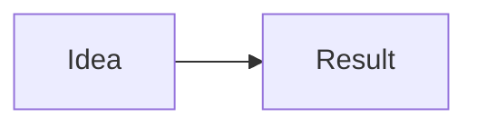

## TL;DR

<!-- 2–3 plain sentences: what someone can see or do after merge, and why. Lead with the user-visible outcome. -->

## How it works

<!-- One “notice this” sentence about the diagram (the idea, not the files). -->

## Summary

<!-- What changed and why. What was left alone. -->

## Files changed

| Purpose | Files |
| --- | --- |
|  |  |

## How to test

- Unit: `command` — result (or “not needed, because …”)
- Smoke: `command` — result (or “not needed, because …”)
- End-to-end: `command` — result (or “not needed, because …”)

## Review

<!-- Findings as fixed / accepted / rejected. No AI tool or model names. -->
