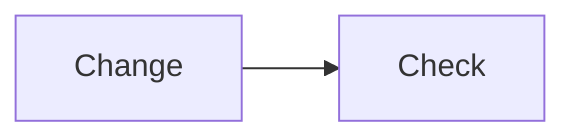

## TL;DR

<!-- Two or three sentences. Say what a person can do after merge. Say why. -->

Replace this paragraph. Say what a person can do after merge.

## How it works

<!-- One sentence about the diagram. -->

The diagram shows the change, then the check.

## Summary

<!-- Say what changed and why. Say what you left alone. -->

Replace this summary. Say what you left alone.

## Files changed

| Purpose | Files |
| --- | --- |
| Fill in one row per purpose | `path` |

## How to test

- Unit: `python3 -m unittest discover -s tests -p 'test_check_*.py' -q` — passed
- Smoke: `python3 scripts/pr_body_check .github/pull_request_template.md --head 0000000000000000000000000000000000000000` — printed `pr-body: ok`
- End-to-end: `python3 scripts/pr_body_check .github/pull_request_template.md --head 0000000000000000000000000000000000000000` — printed `pr-body: ok` and exited 0
- Mac-only:
  - `swift run --package-path capture-helper recall-capture list-sources` — needs macOS 14 and a microphone permission

## Review

Implementer: Grok 4.7
Reviewer: Claude Opus 4.6

<!-- Use a bare name such as Grok 4.7. Do not use a hyphenated model id.
If the reviewer is the same model, name the other models you tried, say why each was unavailable, and write that this was a fresh agent, not the implementing agent. -->

- none yet

Head: `0000000000000000000000000000000000000000`
