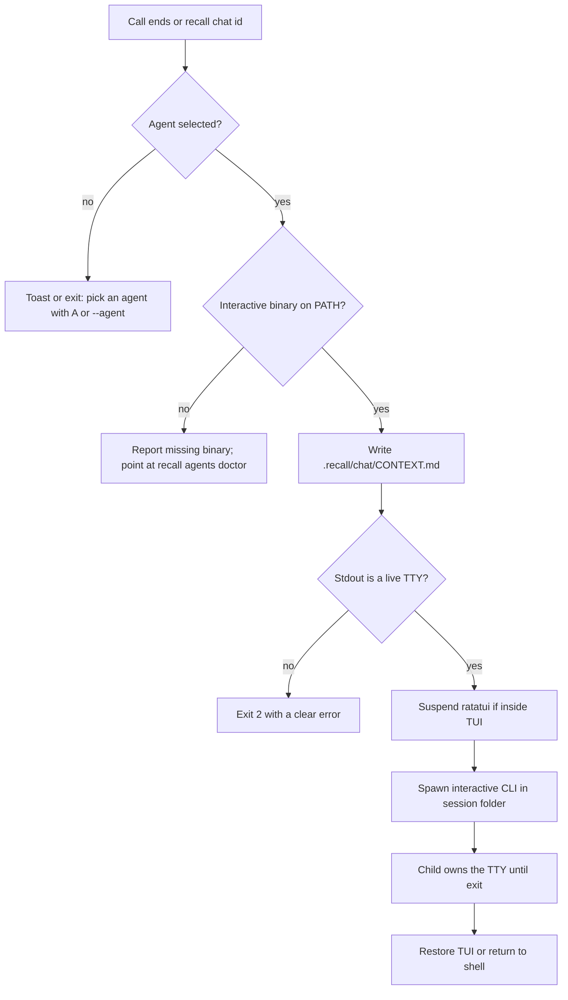

# Post-call chat

Status (this commit): Matthew approved this design with the recommended defaults. This commit lands only the interactive launch map (`ChatLaunchProfile` / `chat_argv`) and the unit test named below. The missing-binary error stays in PR 3 with `recall chat`. Implementation of later PRs still follows the build order.

Recall already runs a headless CLI agent after a call to write `meeting.md`. This design adds an interactive chat on the same agent so you can ask follow-up questions about what just happened. The baseline is commit `76fd97c`, crate version 0.7.5. This document is the design and the build order. It does not change the program.

Implementation waits for an explicit yes. Each pull request below starts from a test that fails, then makes that test pass.

Matthew's request (paraphrased): after a call ends, a shortcut should open an agent session with the meeting as context. The interactive CLI must follow the selected analysis agent (`claude` for Claude, `opencode` for OpenCode, `grok` for Grok, `codex` for Codex, and the same for the other built-in agents).

## What changes

Five pull requests land in this order.

- PR 1 adds the interactive launch map (agent id to argv) and a missing-binary error. It branches from `main`.
- PR 2 writes a regenerable chat context file under the session folder. It branches from `main`. It does not depend on PR 1.
- PR 3 adds `recall chat [id|latest]` for a real TTY. It branches from PR 1 and PR 2.
- PR 4 adds the TUI shortcut and terminal handoff. It branches from PR 3.
- PR 5 wires a picker action once the resume picker screen exists. It branches from PR 4 and from resume-picker PR 3 on `cursor/resume-picker-design-ddfb`.

PR 4 and PR 5 change keys a person presses. Each waits for Matthew's review before merge. PR 1 through PR 3 do not.

Headless `recall analyze` stays as it is. Chat does not replace analysis. Chat does not start during a live take.

## Flow



## How agents work today

Built-in analysis agents live in `known_agents` and `agent_profile` in `src/analysis.rs`. The same ids are what `A` cycles in the TUI and what `--agent` accepts.

| Agent id | Headless command today | Binary doctor key |
| --- | --- | --- |
| `grok` | `grok -p <prompt> --output-format json` | `grok` |
| `cline` | `cline --json <prompt>` | `cline` |
| `codex` | `codex exec --json <prompt>` | `codex` |
| `claude` | `claude --bare -p <prompt> --output-format json` | `claude` |
| `opencode` | `opencode run --format json --pure --title Recall analysis --file <transcript> <prompt>` | `opencode` |
| `pi` | `pi --mode json --no-session <prompt>` | `pi` |

`recall agents doctor` only checks that the binary name exists on `PATH` (`binary_exists` in `src/main.rs`). Analysis runs the child with null stdin and captured stdout. It never gives the child the TUI's terminal.

`docs/AGENT_ANALYSIS.md` says what leaves the machine for analysis: the clean transcript plus timed note and marker text. Pictures are names only. Chat will send at least that much once the interactive agent reads the session folder, and often more if the person asks the agent to open other files.

## Recommended design

Chat is a launch plan plus two entry points. The plan maps the selected agent to an interactive argv, a working directory, and a short first prompt. The entry points are the TUI key and `recall chat`. The recording screen does not embed a second chat UI.

### Entry points

#### TUI

Bind **`C`** (Shift+c) on the dashboard when a session folder exists and capture is not running.

Why `C`:

- Lowercase `c` is consent.
- `A` already cycles the agent. `C` is the next letter that means chat.
- Free letters that are not used on the dashboard today include `b`, `d`, `f`, `g`, `h`, `i`, `j`, `l`, `u`, `v`, `w`, `x`, `y`, `z`. None of those read as chat.

Show it in the footer next to the agent chip: `C chat`. When capture is running, ignore `C` and keep the toast path unused, or show `End the take before chat.` Do not hand off the TTY while mic or system helpers are live.

Require an agent the same way auto-analyze does. If none is selected, toast `Pick an agent with A first.` and stay in the TUI.

#### CLI

Add:

```sh
recall chat [latest|<session-id>|<path>] [--agent <id>]
```

With no id, use `latest` in the current storage place, matching `recall analyze latest`. `--agent` overrides the TUI or config default for that run. Resolve the session through the same helpers `analyze` and `resume` already use (`session_from_arg` / `find_session_target`).

When stdout is not a live terminal (`terminal::stdout_is_live` is false), print a short error and exit 2. Do not spawn an interactive CLI into a pipe.

#### Resume picker

The design on `cursor/resume-picker-design-ddfb` keeps the picker as its own screen. Enter resumes. Esc cancels. Space previews. Ctrl+R renames.

Add **`c`** on the highlighted row to open chat for that session instead of resume. Lowercase `c` is free in the picker. It does not fight consent, which only exists on the recording dashboard.

Chat from the picker:

1. Builds the same launch plan as `recall chat <id>`.
2. Leaves the picker (restore the terminal).
3. Spawns the interactive CLI.
4. Returns to the shell when the child exits. It does not reopen the picker unless a later change asks for that.

If resume-picker PR 3 is not merged yet, ship TUI `C` and `recall chat` first. PR 5 waits for that screen.

### Interactive launch map

Keep one table next to `agent_profile`. Headless args stay for analyze. Chat uses a second profile so `-p` / `exec` / `--mode json` never leak into an interactive session.

| Agent id | Interactive argv (recommended) | Working directory flag | Docs checked |
| --- | --- | --- | --- |
| `claude` | `claude` plus optional initial prompt as a positional arg (not `-p`) | `cwd` of the process; optional `--add-dir <project>` later | [Claude Code CLI reference](https://code.claude.com/docs/en/cli-reference): `claude` and `claude "query"` start interactive mode; `-p` is print/SDK and exits |
| `codex` | `codex` plus optional prompt | `--cd` / `-C <dir>` sets the workspace | [Codex CLI reference](https://learn.chatgpt.com/docs/cli/reference.md) |
| `grok` | `grok` plus optional `--prompt <text>` | `--cwd <dir>` | [Grok Build overview](https://docs.x.ai/build/overview) and [CLI reference](https://docs.x.ai/build/cli/reference); also the xai-grok-shell README table for `--cwd` / `--prompt` |
| `opencode` | `opencode` with optional project path arg, or `opencode` then rely on process cwd | `opencode <dir>` is documented; process `cwd` also works | [OpenCode CLI intro](https://opencode.ai/docs/cli/) |
| `cline` | `cline` or `cline -i`, optional prompt | `-c` / `--cwd <path>` | [Cline TUI](https://docs.cline.bot/usage/tui) and [CLI reference](https://docs.cline.bot/cli/cli-reference) |
| `pi` | `pi` plus optional message and `@file` args | process `cwd`; `@path` resolves from cwd | [Pi CLI docs](https://github.com/earendil-works/pi/blob/main/packages/coding-agent/docs/cli.md) |

Default first prompt (same idea for every agent):

```text
You are in a Recall meeting session folder. Read .recall/chat/CONTEXT.md first, then help me discuss this meeting. Prefer transcript.md and meeting.md over guesses.
```

Pass that prompt only when the agent docs support an initial interactive prompt without switching to headless mode. For OpenCode, prefer process cwd plus the context file, and pass a prompt only through a flag that stays interactive (`opencode mini --prompt` is verified in OpenCode's CLI command list; bare `opencode <prompt>` is not verified here). Prefer the smallest argv that opens a TUI.

#### Missing binary

Reuse `binary_exists` / `binary_path`. Before spawn:

1. Resolve the interactive command name from the chat profile.
2. If missing, show `Missing \`claude\` on PATH. Install it, or run recall agents doctor.` (use the real command name).
3. Do not fall back to another agent.

#### Config override

v1 needs no new config keys. The selected analysis agent is the chat agent.

A later optional override can look like:

```toml
[analysis.chat]
# command = "claude"
# args = []
```

Do not add that until someone needs a wrapper script. Ask first before any new network or download path.

#### Cursor CLI

Matthew named `cursor-agent`. Current Cursor docs install and run the binary as `agent` ([Cursor CLI overview](https://cursor.com/docs/cli/overview), [parameters](https://cursor.com/docs/cli/reference/parameters)). That id is not in `known_agents` today. Leave it out of v1. Adding a seventh analysis agent is a separate product choice.

### Context and working directory

#### What lives in a session folder today

From `src/session.rs` and the resume-picker design:

- `transcript.md`, `meeting.md`
- `.recall/metadata.json`, `.recall/notes.md`, `.recall/markers.md`
- `.recall/state/capture.json`
- `.recall/analysis/overview.json` and per-take analysis debug files
- `audio/` when kept

There is no recorded launch cwd on `main` yet. Resume-picker PR 1 proposes `metadata.context.cwd` and git fields for new sessions only.

#### Compared shapes

Three shapes were compared. The recommendation is the first.

1. **Session folder as cwd, plus a Recall-owned context file.** The agent sees `transcript.md` and `meeting.md` by relative path. Chat always works for old sessions. Project code is not the cwd unless the person `cd`s later inside the agent.
2. **Recorded project cwd as cwd, session path only in the prompt.** Matches “the dir where the session took place” once resume-picker PR 1 ships. Old sessions have no cwd. The agent may miss meeting files unless the prompt forces absolute paths.
3. **Session folder as cwd and `--add-dir` / extra grant for `context.cwd` when present.** Best of both for Claude and Codex. Not every agent has an add-dir flag. More argv special cases.

Recommendation: shape 1 for v1. When `metadata.context.cwd` exists, write that path into `CONTEXT.md` as “Project directory at record time” so the person or the agent can open it. Do not change process cwd to the project in v1.

#### Context file

Write:

```text
.recall/chat/CONTEXT.md
```

Rules:

- Recall owns the path. Chat may regenerate it on every launch.
- Safe to delete. The next chat recreates it.
- Do not write `AGENTS.md` or `CLAUDE.md` into the session folder. Those names belong to coding-agent project config and would confuse both tools and people.
- Do not put secrets into the file. Paths and meeting text only.

Suggested body:

```markdown
# Recall chat context

This file is written by Recall for post-call chat. Recall may overwrite it.
Paths below are relative to the session folder (the process working directory).

- Session id: <folder name>
- Title: <title>
- Project directory at record time: <cwd or "not recorded">
- Transcript: transcript.md
- Meeting notes: meeting.md
- Overview: .recall/analysis/overview.json
- Notes: .recall/notes.md
- Markers: .recall/markers.md
```

If overview or meeting sections are missing, say so in one line. Do not copy the full transcript into `CONTEXT.md`. The interactive agent can read the files.

Also write a tiny sibling `.recall/chat/README.md` once that says the directory is managed by Recall. Optional. Prefer one file if two feel heavy.

### Terminal handoff

Today `run_with_options` in `src/tui.rs` calls `ratatui::try_init`, enables bracketed paste and keyboard flags, runs the app, then pops those flags and calls `ratatui::try_restore`. There is no mid-session suspend helper.

Chat from the TUI must:

1. Refuse when `CaptureState` is recording or helpers are still stopping.
2. Disable mouse capture, pop keyboard flags, leave the alternate screen, and disable raw mode (the same cleanup `try_restore` does).
3. Spawn the child with inherited stdin, stdout, and stderr. Set the child cwd to the session folder. Wait for the child status.
4. Call `try_init` again and restore keyboard flags before the next draw.
5. On child failure, show a toast with the exit status after restore.
6. On panic or signal during handoff, prefer the existing restore path so the user's shell is not left in raw mode. Mirror the cursor-restore caution already used in `update_progress.rs` where needed.

`open_path` in `src/session.rs` starts an editor with `.status()` but does not tear down ratatui first. Do not reuse that for interactive agent CLIs. They need the real TTY without a competing raw mode.

Capture helpers stay idle for the whole child lifetime. Background analyze or transcribe jobs for a detached previous session may still run. That matches today's quit-with-detach behavior. Do not cancel them for chat.

### Privacy and safety

Interactive chat sends meeting text to the same class of network backends analysis already uses when that agent is selected. Defaults:

| Agent | Leaves the machine? | Note |
| --- | --- | --- |
| `claude` | Yes, to Anthropic (or the user's configured Claude backend) | Interactive session can read any file in cwd the tool allows |
| `codex` | Yes, to OpenAI / ChatGPT Codex backends | Workspace sandbox flags exist; v1 does not pass `--yolo` |
| `grok` | Yes, to xAI unless a custom local model is configured in Grok | Auth via browser or `XAI_API_KEY` |
| `opencode` | Depends on the model the user configured in OpenCode | Local or remote |
| `cline` | Depends on the configured provider | |
| `pi` | Depends on the configured provider | |

Recommendation:

- No second consent prompt in v1 when an agent is already selected. Selecting the agent for analysis is the same trust boundary.
- Show one toast before handoff: `Opening claude in <session>… Meeting text may leave this machine.`
- Never pass `--dangerously-skip-permissions`, `--yolo`, or `--always-approve` from Recall.
- Keep audio out of the context file. Do not attach `m4a` files.
- Document the risk next to analysis in `docs/AGENT_ANALYSIS.md` when the feature ships.

A config flag `analysis.chat_confirm = true` can wait for a later change if Matthew wants an explicit yes every time.

## Other approaches

### Embed a chat panel inside ratatui

Rejected for v1. Each vendor TUI already has approvals, models, and streaming. Rebuilding that inside Recall duplicates work and fights raw mode. Handing off the TTY matches how people already use these tools.

### Always open the project cwd

Rejected as the only mode until every session records cwd. Session-folder cwd works for every existing folder on disk.

### One wrapper script per agent

Rejected. A table in Rust stays testable and matches `agent_profile`.

## Build order

Each source pull request bumps the patch version by 1 against its base and updates `Cargo.lock`. Docs-only commits do not. The check for a source pull request is `./scripts/check.sh`.

### PR 1. Interactive launch map

- [x] Depends on nothing. Branch from `main`.
- [x] Edits `src/analysis.rs` (or a small `src/chat_launch.rs` if the file split stays clearer), unit tests, and the crate version.
- [x] Builds `ChatLaunchProfile { command, args }` per known agent, with `{prompt}` substitution, and a pure function that renders argv.
- [x] The result is a testable map. No process is spawned yet.
- [x] Unit. Write `chat_launch_for_claude_is_interactive_not_print_mode` first. It fails while only `agent_profile` exists. Assert Claude's chat argv has no `-p`, Codex chat is not `codex exec`, Grok chat is not only `-p` without a TUI path, and Pi chat is not `--mode json`.
- [x] Live. Not required. `cargo test` is enough.
- [x] Perf. Not applicable.

### PR 2. Context file writer

- [ ] Depends on nothing. Branch from `main`.
- [ ] Edits session or analysis helpers, unit tests, and the crate version.
- [ ] Builds `write_chat_context(session_path) -> PathBuf` that creates `.recall/chat/CONTEXT.md`.
- [ ] The result is a file that lists the meeting paths and says Recall may overwrite it. A second write replaces the file and does not duplicate sections.
- [ ] Unit. Write `write_chat_context_is_idempotent_and_lists_transcript` first. It fails until the writer exists. Assert no `AGENTS.md` is created at the session root.
- [ ] Live. `cargo run` is not required. A temp session fixture is enough.
- [ ] Perf. Not applicable.

### PR 3. CLI `recall chat`

- [ ] Depends on PR 1 and PR 2. Branch from a merge of both, or stack PR 2 on PR 1 after both land.
- [ ] Edits `src/main.rs`, help text, `tests/cli_smoke.rs`, and the crate version.
- [ ] Builds argument parsing, session resolve, binary check, context write, TTY gate, and spawn with inherited stdio.
- [ ] The result is that a piped `recall chat latest` exits 2 without spawning, and on a TTY the child command is the mapped interactive argv with cwd set to the session folder.
- [ ] Unit / smoke. Write `chat_without_a_tty_exits_2` first in `tests/cli_smoke.rs`. It fails because the subcommand is unknown. Add `chat_missing_binary_reports_agent_name` with `PATH` cleared for that binary name.
- [ ] Live. On a Mac with the agent installed, `recall chat latest --agent claude --storage <temp>` opens Claude in the temp session and exits when the user quits Claude. This cloud Linux checkout cannot prove the interactive TUI.
- [ ] Perf. Not applicable.

### PR 4. TUI shortcut and handoff

- [ ] Depends on PR 3. Branch from PR 3.
- [ ] Edits `src/tui.rs` (footer, key, suspend/resume helper), tests, README or SPEC one-liners, and the crate version.
- [ ] Builds `C` on the ended dashboard, footer hint, refuse-while-recording, and terminal suspend/restore around the PR 3 spawn path.
- [ ] The result is that after a take ends, `C` leaves Recall, opens the agent, and returns to the ended dashboard with the same session selected.
- [ ] Unit. Write `shift_c_is_ignored_while_recording` and `shift_c_requests_chat_when_ended` against the key handler or a extracted handoff plan type. They fail until the key exists.
- [ ] Live. Ghostty AppleScript per `AGENTS.md`, temp `--storage`, `--consent provided`, `--agent` set, end a short take, send `C`. Pass predicate: the child process for that agent appears in `pgrep`, and after quit the Recall window still shows the same session id. Close only that Ghostty window.
- [ ] Perf. Not applicable. Fail the PR if handoff runs while a capture lock is held.

This pull request waits for Matthew's review before merge.

### PR 5. Resume picker action

- [ ] Depends on PR 4 and resume-picker PR 3. Branch from that stack.
- [ ] Edits `src/resume_picker.rs` and help text. Bump the crate version.
- [ ] Builds `c` on the highlighted row to launch chat.
- [ ] The result is that `recall resume` picker can open chat without opening the recording TUI.
- [ ] Unit. Write `picker_c_selects_chat_for_highlighted_session` first against the picker state function.
- [ ] Live. Ghostty, temp storage, two sessions, highlight the older one, press `c`, confirm the agent cwd is that session folder.
- [ ] Perf. Not applicable.

This pull request waits for Matthew's review before merge.

## Open questions

These are choices a run cannot settle. The design above already picks one answer so the work can start. Matthew can overrule any of them.

1. Should the TUI key be `C` or a lowercase free letter such as `h`? **Default: `C`.** It reads as chat and does not steal consent.
2. Should process cwd be the session folder or the recorded project cwd? **Default: session folder.** Record the project path in `CONTEXT.md` when known.
3. Should chat confirm that meeting text may leave the machine every time? **Default: no extra prompt in v1.** One toast is enough when an agent is already selected.
4. Should OpenCode use bare `opencode` or `opencode mini --prompt …`? **Default: bare `opencode` with process cwd set, and put the briefing only in `CONTEXT.md`.** Add `mini --prompt` later if bare mode feels too cold.
5. Should the picker reopen after chat exits? **Default: no.** Return to the shell, same as quitting the recording TUI.
6. Should Cursor's `agent` binary join `known_agents`? **Default: not in v1.**
7. Should a missing analysis result still allow chat on transcript-only sessions? **Default: yes.** `CONTEXT.md` says when `meeting.md` is still pending.

## Left unproven

- No interactive agent TUI was launched from this Linux cloud checkout. Flag tables come from vendor docs fetched for this design, not from a local `--help` run on Matthew's Mac.
- OpenCode's exact interactive first-prompt flag on bare `opencode` (not `mini`) was not fully pinned. The docs confirm `opencode`, `opencode <dir>`, and `opencode mini --prompt`.
- Grok's `--prompt` versus a positional interactive prompt was read from the xai-grok-shell README and docs.x.ai CLI reference. A Mac `grok --help` was not run here.
- Cline's `-i` versus bare `cline` both start a TUI per Cline docs. Which form preserves an initial prompt best on Matthew's installed version is unproven.
- Terminal suspend and restore inside the live Recall TUI has not been coded or smoke-tested. Ghostty handoff needs a Mac.
- Resume-picker integration assumes the design on `origin/cursor/resume-picker-design-ddfb` still lands with a separate picker screen and free `c`.
- No measurement of context-file write time was taken. The file is small prose only.
- Whether every agent respects a cwd that is a meeting folder (and not a git root) for trust dialogs is unproven. Expect one trust prompt the first time a session folder is used.

## Sources checked

- Repo: `src/analysis.rs`, `src/tui.rs`, `src/main.rs`, `src/session.rs`, `src/terminal.rs`, `docs/AGENT_ANALYSIS.md`
- Design reference (not merged): `origin/cursor/resume-picker-design-ddfb:docs/design/resume-picker.md`
- Claude Code CLI reference: https://code.claude.com/docs/en/cli-reference
- Codex CLI reference: https://learn.chatgpt.com/docs/cli/reference.md
- OpenCode CLI intro and commands: https://opencode.ai/docs/cli/ , https://opencode.ai/docs/cli/commands/
- Grok Build: https://docs.x.ai/build/overview , https://docs.x.ai/build/cli/reference
- Cline TUI / CLI reference: https://docs.cline.bot/usage/tui , https://docs.cline.bot/cli/cli-reference
- Pi CLI: https://github.com/earendil-works/pi/blob/main/packages/coding-agent/docs/cli.md
- Cursor CLI: https://cursor.com/docs/cli/overview , https://cursor.com/docs/cli/reference/parameters
