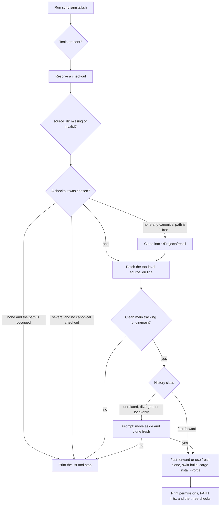

# Install and update

Matthew wants one obvious way to install Recall on a Mac and the same way to update it later. A fresh Mac, a second Mac, and a Mac that already has an older `recall` should not require a different recipe.

He also said this, and this note treats it as a bug in the current design.

> needing to hand-edit config when `source_dir` names a deleted or moved checkout is not acceptable.

The broader bar is zero manual steps beyond one install command and the one-time macOS permission grants. This file records what the program does today at `76fd97c`, the command to build, every step that would still need a person, and the decisions still open. It does not change the program. Building it waits for an explicit yes.

## Real test case

Matthew's Mac is the case this design must fix.

| Fact | Value |
| --- | --- |
| Checkout | `~/Scripts/recall` |
| Tree | clean |
| Branch | `main` |
| `HEAD` | `86d27dc` (`Add recall update --verbose (0.7.2)`) |
| History | old tree from before the GitHub repo was deleted and recreated |
| Ahead / behind | 33 ahead / 38 behind `origin/main` |
| Shared history | none (`git merge-base HEAD origin/main` fails) |
| Installed binary | `~/.cargo/bin/recall` version `0.7.2` |
| Config | `~/.config/recall/config.toml` has `source_dir = "~/Scripts/recall"` |

Today `recall update` (`src/update.rs`) only fast-forwards. On this Mac it refuses. Pull request 8 only skips a missing or invalid `source_dir`. Here `source_dir` is set and valid, so pull request 8 still lands on the same checkout and still fails at the fast-forward.

`~/Scripts/recall` is not on the common-folder list in `src/update.rs`. If `source_dir` were cleared without a rewrite, discovery would miss this tree unless the shell is inside it or the user passes `--repo`.

## What the program does today

### The installed command and the checkout are different things

`cargo install --path . --locked` is the documented way to put `recall` on the command path. `recall update` is a different command. After it finds a checkout it runs `cargo test --locked`, `swift build --package-path <checkout>/capture-helper`, and `cargo install --path <checkout> --locked --force` (`src/update.rs` lines 158-189). The install command does not pass `--root`. Cargo writes the binary into its own bin directory. `docs/PORTABILITY.md` says that directory is usually `~/.cargo/bin`. `CARGO_HOME`, or Cargo's `install.root`, sends it somewhere else. The update code never reads `PATH` and never reads the path of the running executable.

The `--force` flag is only on the update path. `README.md` and `docs/SETUP.md` tell a first install to run `cargo install` without `--force`. Update replaces the Cargo-installed binary. Nothing in `src/update.rs` or `recall doctor` searches `PATH` for a second `recall`. A copy that appears earlier on `PATH` keeps running. The shell never reaches the binary Cargo just replaced.

`recall --version` prints the crate version baked into that binary (`src/main.rs` line 72). The crate version at this commit is `0.7.5` (`Cargo.toml` line 3). The git commit is embedded as `RECALL_BUILD_COMMIT` (`build.rs` lines 31-53). `recall --version` does not print it. If the worktree was dirty at compile time, the commit string ends in `-dirty`. Update treats "already up to date" as true only when the checkout `HEAD` equals `origin/main` and that same string equals `RECALL_BUILD_COMMIT` (`src/update.rs` lines 105-108 and 544-546). A `-dirty` build never matches, so update rebuilds every time.

There is no `scripts/install.sh`. `scripts/install-git-hooks.sh` only sets `core.hooksPath`. `docs/ROLLBACK.md` says Recall has no tags and no GitHub releases. GitHub Issues for this repository has never had an issue. That was checked on 2026-11-14 with `gh issue list --state all`. The commit that added checkout discovery, `c5d5608`, has the subject "Consolidate session output and add safe updates" and no further rationale in the message.

### Finding the checkout is strict, and a bad `source_dir` stops the search

`discover_checkout` in `src/update.rs` lines 224-276 tries these, in order.

1. `--repo`, if you passed it. An invalid path is an error. The search does not continue.
2. `RECALL_REPO`, if the variable is set. Same hard stop.
3. `source_dir` from config, if the key is set. Same hard stop. The error says the checkout from `source_dir` is not valid.
4. The checkout path compiled into the binary, `CARGO_MANIFEST_DIR`.
5. Ancestors of the current directory.
6. One path under `$HOME`, and only if exactly one of these exists and is a valid checkout. `Projects/recall`, `Developer/recall`, `src/recall`, `Source/recall`, `Code/recall`, `code/recall`, `Workspace/recall`, `workspace/recall`, `Documents/recall`, `Documents/GitHub/recall`, `Documents/Projects/recall` (`src/update.rs` lines 690-710).

A valid checkout has `Cargo.toml`, `capture-helper/Package.swift`, a git root equal to that directory, and `origin` pointing at `github.com/matthewpergolski/recall` (`src/update.rs` lines 292-320). `https`, `ssh`, and `git@` forms of that remote are accepted.

Two valid common locations produce an error that lists them and tells you to pass `--repo`. Zero locations produce an error that names `--repo`, `RECALL_REPO`, and `source_dir`. Update never clones.

While the compiled-in checkout still validates, it is chosen before the current directory. `recall update` run inside a second clone updates the clone this binary was built from. The directory you are standing in is used only when that compiled-in path no longer validates, and no earlier source named a checkout. When `main` is behind `origin/main`, the fast-forward moves `HEAD`. When `main` has commits that are not on `origin/main`, the command refuses to install. The error still says "Recall pulled safely" (`src/update.rs` line 413). The code fetches, then runs `git merge --ff-only`.

`docs/SETUP.md` describes a different order. It says the updater uses the embedded checkout first, then `RECALL_REPO`, then `source_dir`. `docs/PORTABILITY.md` matches the code. An invalid `source_dir` does not fall through in either document. The code returns at `src/update.rs` lines 236-238.

That is one bug. After a checkout is deleted or moved, `source_dir` still names the old path. The next `recall update` stops. The config file has to be edited by hand before any later candidate is tried. A second clone that sits in `~/Projects/recall` is ignored for as long as the stale key is set.

The real test case is a second bug. `source_dir` is valid. The official remote is correct. The tree is clean and on `main`. Fast-forward still fails because the local history does not share a commit with `origin/main`.

Update also refuses a dirty tree, a branch other than `main`, an upstream other than `origin/main`, and a `main` that is not exactly `origin/main` (`src/update.rs` lines 365-414). It does not reset, stash, or discard. A fast-forward uses `git merge --ff-only`.

### The helper stays inside the checkout that compiled `recall`

`build.rs` does not run `swift build`. At runtime the mic recorder, the system-audio recorder, source listing, and Apple Speech all look for a debug binary under the compiled-in checkout.

The three paths, first hit wins, are `capture-helper/.build/debug/recall-capture`, `capture-helper/.build/arm64-apple-macosx/debug/recall-capture`, and `capture-helper/.build/x86_64-apple-macosx/debug/recall-capture` (`src/mic_recorder.rs` lines 261-268, and the same list in `src/system_recorder.rs`, `src/capture_sources.rs`, and `src/transcription.rs`). There is no release path. If none of those files exist, Recall runs `swift run recall-capture` with the working directory set to that `capture-helper` folder.

The fresh-install docs never run `swift build`. Update, the move steps in `docs/PORTABILITY.md`, and the rollback steps in `docs/ROLLBACK.md` do. Until a debug binary exists, the first capture pays for a Swift build, and only if the compiled-in checkout is still at that path. Move the folder without reinstalling and the helper lookup points at the old path. `docs/PORTABILITY.md` says packaging the helper into the installed command is later work. `README.md` still lists packaging as in progress.

`recall-capture version` prints `recall-capture 0.1.0` (`capture-helper/Sources/RecallCapture/main.swift` lines 324-325). That string is not the crate version. Doctor never runs it.

### Doctor checks the toolchain

`recall doctor` prints and exits 0. Extra words are ignored, so `recall doctor transcription` is the same command. `docs/DEPENDENCIES.md` lists `recall doctor transcription` and `recall setup transcription` as future commands.

Doctor reports `rustc`, `cargo`, and `swift` on `PATH`, then `swift` a second time as the helper runner. It tells you to run `recall audio-tap-probe`. It does not run the probe and it does not look for `recall-capture` (`src/main.rs` lines 1355-1362). A missing helper shows up only inside the Apple Speech lines, and only when `swift` is also missing. When `swift` is on `PATH`, doctor resolves the helper to the package directory and can end up driving `swift run` (`src/transcription.rs` lines 1253-1282).

Doctor does not print the running `recall` path, the crate version, `RECALL_BUILD_COMMIT`, or the checkout `HEAD`. It does not warn about a second `recall` on `PATH`. It does not read microphone or system-audio permission. The helper can report microphone status from `list-sources` (`capture-helper/Sources/RecallCapture/main.swift`). `recall sources` is what surfaces it. System-audio permission belongs to the terminal that launched Recall (`docs/SETUP.md` lines 198-216, `README.md` lines 35-37). The `recall` binary has no grant of its own.

### Settings survive a reinstall on the same Mac

Config is `$XDG_CONFIG_HOME/recall/config.toml` when that variable is set, including when it is empty. Otherwise it is `$HOME/.config/recall/config.toml` (`src/config.rs` lines 159-167). `session-places.txt` sits beside that file (`src/places.rs` lines 16-30). `RECALL_SESSION_PLACES` points the list at another file. There is no `RECALL_CONFIG`.

Nothing in the product writes `config.toml`. The parser skips unknown keys and comments. A missing file loads defaults. `recall update` reads `source_dir` and does not open the file for writing. It does not open `session-places.txt`. Session folders, `models/`, and `tools/` stay where they are. A new clone does not contain them. `.gitignore` ignores `models/`, `tools/`, `sessions/`, and `capture-helper/.build/`.

`keep_audio` accepts only the bare words `true` and `false` (`src/config.rs` lines 180-186). Quoted `"false"` is ignored, and an ignored value means keep the audio.

`default_storage_dir` joins the current directory with `sessions` (`src/session.rs` lines 124-126). Config copies `storage_dir` into the run options (`src/main.rs` line 901). A later `--storage` flag replaces that value (`src/main.rs` lines 961-965). The TUI uses the option when it is set, and otherwise calls `default_storage_dir` (`src/tui.rs` lines 192-195). The places list is a path per line. `recall places` prints `missing` when a path is not a directory. Temp directories are not recorded.

Copying `config.toml` to a new Mac does not copy `session-places.txt`, the session folders, model files, the checkout, or the binary. A `source_dir` or `storage_dir` written as an absolute path still names the old disk. A `~/` value expands with the new `HOME`. Microphone and system-audio grants stay with the terminal app on that Mac. They are not files in `~/.config/recall`.

Whisper model lookup adds two files under `~/Library/Application Support/recall/models/` and keeps one only when that file exists (`src/transcription.rs` lines 1082-1087). The Parakeet cache uses that folder only when the directory itself exists (`src/transcription.rs` lines 1501-1505). Install and update do not fill either place.

### The docs leave the choice open

A reader of `README.md` or `docs/SETUP.md` clones the repo and runs `cargo install --path . --locked`, or skips the install and uses `cargo run`. Later they are told to run `recall update` from any directory. Neither page installs the Command Line Tools, rustup, git, or ffmpeg. `docs/DEPENDENCIES.md` says ffmpeg comes from Homebrew or a corporate binary, and the Homebrew block installs `whisper-cpp` only. `recall update` does not install ffmpeg, `parakeet-mlx`, `whisper-cli`, or model weights (`docs/DEPENDENCIES.md` line 63).

The default engine on Apple Silicon macOS 26 and later is on-device Apple Speech. That path has no install command. Parakeet is a fallback you install with `uv tool install parakeet-mlx`. Homebrew is allowed for ffmpeg and for `uv`. The docs say not to expect a Homebrew formula for `parakeet-mlx`. They never offer `brew install recall`, a prebuilt binary, or a curl installer.

## Four flows

### Fresh Mac

Today you install the Command Line Tools, rustup, and git yourself. You clone. You run `cargo install` without `--force` and without `swift build`. You grant Microphone and System Audio Recording Only to the terminal that will launch Recall, then quit that app and open it again. You notice ffmpeg only when a transcription needs it.

The design replaces the clone, the Swift build, and the Cargo install with one command. The Apple dialogs stay.

### Mac with an older install

Today the docs still say `cargo install` without `--force`, which is the first-install line, or `recall update`, which only works when discovery finds a clean official checkout that can fast-forward. An older binary that has no `update` subcommand cannot repair itself. A `0.7.2` binary has `update`, but that binary only fast-forwards, so the real test case stops. A binary that has `update` and a stale `source_dir` stops and asks for a config edit. A second `recall` earlier on `PATH` is invisible.

The design uses the same command as a fresh Mac. That curl line is how a `0.7.2` binary reaches the new logic. The script does not call the old `recall update`. It finds the checkout itself, repairs history when needed, replaces `~/.cargo/bin/recall`, builds the helper in the checkout it uses, and rewrites a stale `source_dir`. It does not delete other binaries. Doctor names them.

### Routine update

Today `recall update` is the right command only when the checkout is clean, on `main`, tracking `origin/main`, shares history with `origin/main`, and discovery succeeds. If `HEAD` already matches the embedded commit, update prints `Already up to date (<version>).` and does not rebuild a deleted helper.

The design keeps that fast path for a clean match, and the one install command remains safe to run when you are not sure. Both enter the same checkout repair.

### Moving settings to another Mac

Today a reinstall on the same Mac leaves `config.toml` and `session-places.txt` in place. A new Mac starts empty. Copied session paths read as `missing` until the folders are there. Copied `source_dir` is the bug above.

The design does not sync settings. If you copy the two files onto the new Mac first, the install command rewrites a stale `source_dir` and leaves every other line alone. Session folders stay a copy you do yourself. Permission grants are new on that Mac, per terminal app.

## Stale states

Each state below names detection, action, exact user-facing output, and a test. The command never deletes user files. It never runs `git reset --hard`, stash, rebase, or force-push. It never rewrites config except the top-level `source_dir` line. It never opens `session-places.txt`, session folders, `models/`, or `tools/`.

### 1. Clean checkout with diverged or unrelated history

This is the real test case.

**Detection.** After a successful fetch of `origin/main`:

1. Run `git merge-base HEAD refs/remotes/origin/main`.
2. If that command fails, the histories do not share a commit. Call this **unrelated**.
3. If that command succeeds, and `HEAD` is not an ancestor of `origin/main`, and `origin/main` is not an ancestor of `HEAD`, call this **diverged**.
4. If `origin/main` is an ancestor of `HEAD` and the tips differ, the checkout has **local-only commits** (state 4).
5. If `HEAD` is an ancestor of `origin/main` and the tips differ, a normal fast-forward is enough. No prompt.

**Action.** For unrelated or diverged history on a clean `main` that tracks `origin/main`:

1. Print the prompt below and wait for one answer. Enter or `y` means yes. `n` means no. `--yes` means yes. When stdin is not a terminal and `--yes` was not passed, print the non-interactive line and exit.
2. On no, stop. Leave the checkout where it is.
3. On yes, choose an aside path `<checkout>-old-<YYYY-MM-DD>`. If that path exists, append `-2`, then `-3`, and so on, until the name is free. Never overwrite.
4. List unique local commits before the move. Unique means commits reachable from `HEAD` that are not reachable from `refs/remotes/origin/main`. When the histories are unrelated, that is every commit on local `main`. Print up to eight subjects, newest last, and a count of any earlier ones. Use the same subject rules as today's change notes (`src/update.rs` `note_lines`).
5. `git -C <parent> mv <checkout-name> <aside-name>` when both paths share a parent and the filesystem rename is enough. Otherwise stop and name both paths. Do not copy. Do not delete.
6. `git clone https://github.com/matthewpergolski/recall.git <original-path>`. Clone into the same path the broken checkout used (`~/Scripts/recall` in the real test case). Do not force `~/Projects/recall` when repairing in place.
7. Patch top-level `source_dir` to that absolute path when the rules in "A stale `source_dir` heals itself" say to write.
8. Continue with `swift build` and `cargo install --path <checkout> --locked --force`.

The aside tree keeps every file and every commit. The user can open it later. The new clone does not contain sessions, models, or tools from the aside tree. Those stay where they already lived outside the checkout, or inside the aside tree if the user had put them there.

**Output.**

```text
Checkout /Users/matthew/Scripts/recall does not share history with origin/main.
Local main is 33 commits ahead and 38 commits behind origin/main.
Move it to /Users/matthew/Scripts/recall-old-2026-11-19 and clone a fresh copy into /Users/matthew/Scripts/recall? [Y/n]
```

On yes, before the move:

```text
Keeping local commits in /Users/matthew/Scripts/recall-old-2026-11-19
Unique local commits
  and 25 earlier
  · …
  · Add recall update --verbose (0.7.2)
Moved /Users/matthew/Scripts/recall to /Users/matthew/Scripts/recall-old-2026-11-19
Cloned origin/main into /Users/matthew/Scripts/recall
```

Then the normal build and install lines. On no:

```text
Left /Users/matthew/Scripts/recall unchanged. Re-run with --yes to move it aside and clone fresh, or pass --repo <path> to use another checkout.
```

Non-interactive without `--yes`:

```text
Checkout /Users/matthew/Scripts/recall does not share history with origin/main. Re-run with --yes to move it aside and clone fresh.
```

**Test.**

- Fixture A: two unrelated git repos, both with the official remote URL, clean `main` tracking a fake `origin/main`. The repair function prints the prompt text (or accepts `--yes`), renames to `…-old-<date>`, clones a stand-in into the original path, and leaves every file from the old tree under the aside path.
- Fixture B: shared root, then diverge both sides. Same aside behavior. The unique-commit list includes a subject that exists only on the local side and excludes a subject that exists only on `origin/main`.
- Assert no `git reset`, stash, rebase, or `rm -rf` in the repair path.
- Assert `session-places.txt` and a sibling config key other than `source_dir` are byte-identical after the run.

### 2. Old binary that predates the fix

**Detection.** The running file is any `recall` built before this design ships. The real test case is `0.7.2`. That binary has `recall update`, but its update path only fast-forwards and treats a set `source_dir` as a hard pin. A still older binary may have no `update` subcommand.

**Action.** The old binary cannot load new Rust code. The bootstrap is the curl line. `scripts/install.sh` does the checkout repair itself. It does not call `recall update` on the old binary. After it runs `cargo install --force`, the shell's next `recall update` is the new binary.

Until `scripts/install.sh` exists on `origin/main`, the documented escape for the real test case is manual: move `~/Scripts/recall` aside, clone into that path, run `cargo install --path . --locked --force`, and keep config and sessions where they are. That escape is temporary. The design replaces it with the curl line.

**Output.** Docs and the script's own header show one line:

```text
curl -fsSL https://raw.githubusercontent.com/matthewpergolski/recall/main/scripts/install.sh | sh
```

When an old `recall update` fails on unrelated history, keep today's error shape until that binary is replaced. Do not teach the old binary new messages. The repair lives in the script and in the new binary.

**Test.**

- `scripts/install.sh --plan` against a fixture that mimics `0.7.2` + unrelated `source_dir` checkout prints that it will move the checkout aside, clone, build the helper, and `cargo install --force`. It does not print a call to `recall update`.
- A docs check fails if `README.md` or `docs/SETUP.md` tells a stale install to run `recall update` as the only repair path.

### 3. Dirty or off-main checkout

**Detection.**

- Dirty: `git status --porcelain --untracked-files=normal` is not empty.
- Off-main: `git branch --show-current` is not `main`, or `@{upstream}` is not `origin/main`.

**Action.** Stop. Do not move the tree aside. Do not stash. Do not reset. Do not switch branches. Print the status or the branch. The user cleans the tree or checks out `main` by hand, or passes `--repo` to a clean install checkout. Day-to-day edits belong in a second clone. The install checkout is the one the command fast-forwards or repairs.

**Output.** Keep today's words, plus a pointer to the install command when the tree is the configured install checkout:

```text
Recall checkout has uncommitted changes. Commit, discard, or move them before updating:
 M src/main.rs
```

```text
Recall updates require the main branch; current branch is 'feat/notes'.
```

```text
Recall main must track origin/main before updating; current upstream is 'origin/feat/notes'.
```

**Test.**

- Dirty fixture: repair refuses, aside path is absent, dirty file still dirty.
- Branch `feat/x` fixture: same refusal.
- Upstream not `origin/main`: same refusal.
- Assert the message does not contain `reset`, `stash`, or `checkout -B`.

### 4. Local commits not in origin

**Detection.** After fetch, `git merge-base HEAD origin/main` succeeds, `origin/main` is an ancestor of `HEAD`, and `HEAD != origin/main`. Local `main` is strictly ahead.

**Action.** Never fast-forward over those commits. Never rebase. Never reset. Default: one prompt that offers the same aside-and-clone path as state 1, so the commits stay in the aside tree and the install path returns to `origin/main`. On no, stop and leave the checkout unchanged. Doctor lists the unique local subjects when it can read the checkout.

**Output.**

```text
Local main has 2 commits that are not on origin/main.
Move /Users/matthew/Scripts/recall to /Users/matthew/Scripts/recall-old-2026-11-19 and clone a fresh copy? [Y/n]
```

On yes, print the unique-commit block from state 1, then the move and clone lines. On no:

```text
Left /Users/matthew/Scripts/recall unchanged. Recall will not install commits that are only on the local main.
```

**Test.**

- Fixture with two local-only commits on clean `main`. Without `--yes` and without a tty answer, exit non-zero and leave `HEAD` unchanged.
- With `--yes`, aside path contains both commit subjects, new clone `HEAD` equals the fixture's `origin/main`, and the unique-commit output names both subjects.

### 5. Multiple checkouts, or `source_dir` points at the wrong one

**Detection.**

- Several valid common folders and no canonical `~/Projects/recall`.
- `source_dir` is set and valid, but that checkout fails the history checks above, while another discovered checkout is clean and can fast-forward.
- `source_dir` is set and valid and points at a tree the user no longer wants as the install checkout.

**Action.** A valid `source_dir` still wins for discovery. The command does not silently switch to another clone. If that pin fails history repair and the user says no to aside-and-clone, stop and list other valid checkouts that were found. `--repo <path>` selects one checkout for this run and writes `source_dir` to that absolute path. `RECALL_REPO` does the same when it is set and valid.

When `source_dir` is missing or invalid, fall through as in "A stale `source_dir` heals itself". Prefer the compiled-in checkout, then a current-directory ancestor, then `~/Projects/recall`, then exactly one other common folder.

**Output.** When several common checkouts remain and none is canonical:

```text
Multiple Recall checkouts were found:
  - /Users/matthew/Developer/recall
  - /Users/matthew/Documents/recall
Choose one with `recall update --repo <path>` or re-run the install command with --repo <path>.
```

When the pinned checkout refused repair and others exist:

```text
Left /Users/matthew/Scripts/recall unchanged.
Other checkouts:
  - /Users/matthew/Projects/recall
Choose one with --repo <path>. That path is written to source_dir.
```

**Test.**

- Two common checkouts, no `~/Projects/recall`, no `source_dir`: error lists both, writes nothing.
- Valid `source_dir` to checkout A, plus a healthy `~/Projects/recall`: discovery returns A.
- After `--repo` to B: top-level `source_dir` becomes B's absolute path, and a second run without flags uses B.

### 6. Second `recall` binary on `PATH`

**Detection.** Doctor, and the end of the install script, run `which -a recall` (or walk `PATH` and collect every `recall` file). More than one hit means a shadow.

**Action.** `cargo install --path <checkout> --locked --force` replaces only Cargo's installed binary (usually `~/.cargo/bin/recall`). Do not unlink any other file. Print every hit in order and say which one the shell runs. The user removes a shadowed binary by hand if that is what they want.

**Output.**

```text
Several recall binaries are on PATH:
  1. /usr/local/bin/recall (shell uses this one)
  2. /Users/matthew/.cargo/bin/recall
Remove the ones you do not want, or put /Users/matthew/.cargo/bin earlier on PATH.
```

**Test.**

- Doctor function fed two paths prints both lines and names the first as the one the shell uses.
- Install / update tests never call `rm` on a path outside the checkout aside rename and never call `unlink` on a `recall` binary.

## Recommendation

| Class | States | Why |
| --- | --- | --- |
| Auto-repair, no prompt | Invalid or missing `source_dir` fall-through and patch; clean `main` that can fast-forward; helper build; `cargo install --force` into Cargo's bin | Safe. No local commit is moved. No file outside the top-level `source_dir` line is rewritten. |
| One prompt | Missing tools (decided 2026-11-14: "install, with one prompt"); unrelated or diverged history aside-and-clone; local-only commits aside-and-clone | Needs a yes because a directory rename or a tool install is a real change. The default answer is yes. `--yes` is the non-interactive yes. |
| Stay manual | Dirty tree; branch other than `main`; upstream other than `origin/main`; deleting a shadowed `recall` on `PATH`; macOS permission grants; copying sessions to a new Mac; choosing among two healthy checkouts without `--repo` | A person has to decide what to keep. The command must not stash, reset, switch branches, or delete binaries it did not install. |

Bootstrap rule: any binary at or older than `0.7.2` reaches this design only through `scripts/install.sh` (the curl line). After that install, `recall update` shares the checkout repair and does not install tools and does not clone from nothing. Aside-and-clone during repair is allowed for both the script and the new `recall update`, because the original path is restored with a fresh official tree.

## The design

This is the behavior to build. The program does not do it yet.

The one line the docs show is this.

```sh
curl -fsSL https://raw.githubusercontent.com/matthewpergolski/recall/main/scripts/install.sh | sh
```

That line is the install and the update, on a Mac that has never seen Recall and on a Mac that already has it. The file it runs is `scripts/install.sh` in the checkout after the first success. The docs do not offer the checkout path as a second recipe. `recall update`, after the binary from this design is installed, runs the same checkout repair. It does not install tools. It does not clone when no checkout exists. It may aside-and-clone when an existing install checkout fails the history checks and the user says yes. A Mac with no `recall` binary uses the curl line.

The script is idempotent. A second run that finds the toolchain, a clean checkout at `origin/main`, a helper binary, and Cargo's `recall` binary built from that commit does the checks and exits. It does not discard git changes. It does not delete session files, model files, or `session-places.txt`. It does not rewrite any config line except a top-level `source_dir`, and only in the cases below.

### What the script does

1. Look for three tools. Xcode Command Line Tools, via `xcode-select -p`. rustup, via a `rustc` that `rustup show active-toolchain` can see. ffmpeg, via `command -v ffmpeg`.
2. When any of those are missing, print one line and wait for one answer. The line names only the missing tools, in that order.

```text
Missing: rustup, ffmpeg. Install them? [Y/n]
```

Enter or `y` means yes. `n` means no. `--yes` skips the question and means yes. When stdin is not a terminal and `--yes` was not passed, print `Missing: rustup, ffmpeg. Re-run with --yes to install them.` and exit. Do not read stdin. When nothing is missing, print no question.
3. On yes, install each missing tool. Xcode Command Line Tools: `xcode-select --install`, then wait until `xcode-select -p` works or you cancel the dialog. rustup: the upstream noninteractive install into `~/.cargo`. ffmpeg: `brew install ffmpeg` when `brew` is present. When `brew` is absent, print the hint from `src/transcription.rs` and continue. On no, stop and name what is still missing.
4. When `rustc` is present, older than `rust-version` in `Cargo.toml`, and owned by rustup, run `rustup update stable`. Do not run `rustup default stable`. When `rustc` is present and rustup does not own it, leave it alone. If that compiler is older than `rust-version`, print that and stop.
5. Choose a checkout with the rules in the next section. If none exists, `git clone https://github.com/matthewpergolski/recall.git` into `~/Projects/recall`. If that path exists and is not a valid Recall checkout, stop. Do not delete it.
6. Patch the top-level `source_dir` line when the rules say to write it. Do this before the git check, so a later refusal still leaves the checkout recorded.
7. If the checkout is dirty, or not on `main` tracking `origin/main`, stop and print the git status or the branch. Do not stash and do not reset.
8. Fetch `origin/main`. Classify history as in "Stale states".
9. When a normal fast-forward is possible, run `git merge --ff-only`.
10. When history is unrelated, diverged, or local-only ahead, run the aside-and-clone prompt from states 1 and 4. On no, stop. On yes, move aside, report unique commits, clone into the original path, and continue.
11. `swift build --package-path <checkout>/capture-helper`.
12. `cargo install --path <checkout> --locked --force`. No `--root`. That replaces Cargo's installed `recall` binary, which is usually `~/.cargo/bin/recall`.
13. If `command -v recall` fails and the new binary is in Cargo's bin directory, append `export PATH="$HOME/.cargo/bin:$PATH"` to the shell rc when that line is absent. This run invokes the binary by its full path.
14. Print every `recall` on `PATH` when there is more than one.
15. Print the permission steps for the terminal that launched the script. Print `recall doctor`, `recall sources`, `recall audio-tap-probe`, and the instruction to play system audio and watch the Call meter. Print that Apple Speech needs an on-device model Recall does not download.

`recall update`, once rebuilt by this design, starts at step 5. It does not install the Command Line Tools, rustup, or ffmpeg. If no checkout exists it prints the one script command and exits. It does not clone from nothing. It does run aside-and-clone when the chosen checkout fails the history checks and the user says yes. The script is the only cloner for a machine with no checkout. That keeps a surprise `recall update` from creating `~/Projects/recall` on a machine where you were not asking for a clone.

The script does not call the old `recall update` to decide where the checkout is. An older binary still has the hard stop on `source_dir` and still only fast-forwards. The script finds the checkout itself, repairs history when needed, installs the new binary, and only then is `recall update` safe.

### A stale `source_dir` heals itself

This is the missing-path bug fix. Discovery no longer treats a set `source_dir` as fatal when that path is missing or is not a valid Recall checkout. A set and valid `source_dir` that fails history checks is handled by the aside-and-clone prompt, not by silent fall-through.

Resolution order.

1. `--repo` when passed. The path must be valid. This run writes `source_dir` to that absolute path, so the next run does not need the flag.
2. `RECALL_REPO` when set. The path must be valid. This run writes `source_dir` the same way. A wrong value is an error and the search stops, because you set it for this process.
3. `source_dir` when it is set and valid. Use it. Write nothing yet.
4. When `source_dir` is missing, or set and invalid, remember that it needs a write and keep looking.
5. The compiled-in checkout, when it is valid.
6. A valid ancestor of the current directory.
7. `~/Projects/recall`, when it is valid. This is the canonical clone. It wins over other common folders so two leftover clones do not block you when the canonical one is present.
8. Exactly one other valid common folder from the list already in `src/update.rs`.
9. Otherwise stop and print every valid checkout that was found. Print the one script command when the list is empty.

A checkout moved to a path that is not on the common list is found when you run the script from inside that directory. The ancestor walk selects it, and the patch writes `source_dir`. Running the script from your home directory in that case clones a new `~/Projects/recall` and leaves the moved tree where it is. Run the script once from the moved tree when that tree is the one to keep. The real test case does not need that walk, because `source_dir` already names `~/Scripts/recall`.

When step 4 marked the key as needing a write, and a checkout was chosen, patch the file as text. The current parser drops comments and unknown keys, so a round trip through it would delete them. It also reads `source_dir` only in the top-level table (`src/config.rs` lines 96-97). A line written after `[transcription]` is invisible, and the next run would append another one.

The patch replaces one top-level line that starts with `source_dir` and optional spaces around `=`. A line under a `[section]` is left alone. If no top-level line exists, insert `source_dir = "<absolute path>"` before the first `[section]` heading. If the file has no heading, append that line. If the file does not end in a newline, write one before the new line so the previous key stays intact. A second run finds the top-level line and does not add another. If the file does not exist, create it with only that line. Paths are quoted so a space survives `parse_string`. `session-places.txt` is not opened.

Doctor grows five checks. None of them start a Swift build.

- `source_dir` missing, or set and invalid. Print the path and the reason. When another checkout would be chosen, print the path the next update will write.
- History class of the chosen checkout: ok, unrelated, diverged, local-only ahead, dirty, or wrong branch. When aside-and-clone would run, say so.
- Every `recall` on `PATH`, in order. When more than one exists, say that the shell runs the first. Do not delete any of them.
- The three helper binaries. When none exist, say so, even if `swift` is on `PATH`.
- `recall <crate version>`, `RECALL_BUILD_COMMIT`, and the checkout `HEAD`. Warn when the commit and `HEAD` differ.

Doctor still exits 0. It is a report. `recall --version` stays the crate version so existing callers do not break.



`recall update` enters at "Resolve a checkout" and does not install tools. An empty result prints the script command instead of cloning.

### What the command refuses to touch

Session folders, `session-places.txt`, every config key other than a top-level `source_dir`, `models/`, `tools/`, and the Application Support model files. A dirty checkout. Any git remote that is not the official repository. Any binary outside Cargo's bin directory. macOS permission decisions. The aside tree after a rename.

## Steps that still need a person

The goal is one command plus the permission grants. This is every manual step in the current setup, and what happens to it.

| Step today | What removes it |
| --- | --- |
| Install Xcode Command Line Tools by remembering `xcode-select --install` | The script puts it on one missing-tools line. On yes it runs `xcode-select --install` and waits. The Apple dialog still needs a click. |
| Install rustup, and update it when `rustc` is older than `Cargo.toml` | The same one line offers rustup when it is missing. On yes the install goes into `~/.cargo`. `rustup update stable` runs only when the active `rustc` is older than `rust-version` and rustup owns that compiler. A compiler rustup does not own is left unchanged. |
| `git clone` | The script clones into `~/Projects/recall` when no valid checkout exists. Aside-and-clone restores the original path when history repair runs. |
| `cargo install` without `--force`, and a separate `swift build` | The script always builds the helper and always installs with `--force`, so Cargo's installed `recall` binary is replaced. That file is usually `~/.cargo/bin/recall`. |
| Remember `recall update` versus `cargo install` | The docs show one curl line. Re-running it updates. `recall update` calls the same repair after the new binary is installed, and it is not a second install recipe. |
| Edit `source_dir` after a move or a delete | Fall through, then patch the top-level line. |
| Repair a recreated-repo checkout by hand | One aside-and-clone prompt. Unique local commits stay in `<path>-old-<date>` and are printed. |
| Run the command from home after the checkout moved somewhere outside the common list | The ancestor walk finds that tree only when the command's current directory is inside it. The curl line from home would clone a new `~/Projects/recall`. Run that same curl line once from inside the moved tree so `source_dir` records it. |
| Pass `--repo` on every update when two clones exist | Prefer the compiled-in checkout, then `~/Projects/recall`. A remaining pair with no canonical checkout is printed once. `--repo` writes `source_dir`, so the choice does not recur. |
| Put `~/.cargo/bin` on `PATH` | If `cargo` is missing, rustup writes the shell profile. If `cargo` is already installed and `command -v recall` still fails, the script appends the `export PATH` line when it is absent. This run uses the full path to the new binary. |
| Run `recall doctor`, `recall sources`, and `recall audio-tap-probe`, then watch the Call meter | The script prints those three commands and the meter instruction at the end. The meter watch stays. A created `call.m4a` can be silence, so the file is not the check. |
| Install the on-device Apple speech model | Stays manual. Recall does not auto-download Apple speech assets (`docs/TRANSCRIPTION.md` line 166). The script and doctor say so. Starting that download from the script would cross the line the transcription docs already draw. |
| Install ffmpeg | The same one line offers ffmpeg when it is missing. On yes, `brew install ffmpeg` when `brew` exists. When `brew` does not exist, the script prints the hint in `src/transcription.rs` and continues. The no-brew case stays manual. |
| Install `parakeet-mlx` or a Whisper model | Not part of the default Apple Speech path. The command does not install them. They stay manual, and only if you select that engine. |
| Grant Microphone to the launching terminal | Cannot be removed. A script that granted this would be a permission bypass, which Recall does not do. The script names the terminal and the Settings pane. Doctor repeats the same lines. |
| Grant System Audio Recording Only, then quit and reopen that app | Same constraint. A new shell tab is not enough. The script says to quit the app. Each terminal app is a separate grant. Apple Terminal, Ghostty, VS Code, and Codex stay separate. |
| Clean a dirty install checkout, or get it back onto `main` | Stays manual on purpose. The command does not stash or reset. Doctor names the dirty files or the branch. Day-to-day edits belong in a second clone. The install checkout is the one the command fast-forwards or repairs. |
| Delete a stray `recall` that appears before `~/.cargo/bin` on `PATH` | Doctor prints every match and says which one the shell runs. The command does not unlink a binary it did not install. |
| Copy `config.toml` and `session-places.txt` to a new Mac | Stays manual. The command does not pull settings over the network. If you copy the files first, only a stale `source_dir` is rewritten. Session folders are a separate copy. `recall places` already prints `missing` for a path that is not on this Mac. |
| Choose a stable `storage_dir` | Stays unset. The default remains `<current directory>/sessions`. `~/Documents/Recall/sessions` is a poor default because Documents may be in iCloud, and doctor already warns on that. Set `storage_dir` yourself if you want one folder. |

## Alternatives

A Homebrew tap was the obvious package. It fails the constraints that already shape Recall. The app is one personal repository, updated from `origin/main` by a local build. The helper is a Swift package built inside the checkout. Homebrew would add a formula and a bottle, and a bottle still would not hold the microphone grant, because that grant belongs to the terminal that launches `recall`. `docs/DEPENDENCIES.md` already says the app must not assume Homebrew. Homebrew remains acceptable for ffmpeg on a personal Mac. It is the wrong home for `recall` itself.

A prebuilt release binary has the same gap, and `docs/ROLLBACK.md` says there are no GitHub releases yet. A binary built on one Mac embeds `CARGO_MANIFEST_DIR` from that Mac. Copied to a second Mac, the helper lookup points at a path that is not there. Shipping a binary means changing helper discovery first. That is real work, and it is larger than the bugs above. This plan leaves packaging as the future task `docs/PORTABILITY.md` already names.

A signed Recall application would let macOS attach the grants to Recall instead of to the terminal. That is a different product. The current permission model is deliberate. `docs/SPEC.md` lists bypassing permission prompts as a non-goal. This plan does not change who holds the grant.

Making `recall update` the only command cannot cover a Mac with no `recall` binary. The curl line is the command that exists before the binary does. After the first successful run, `recall update` shares the checkout repair. The docs show the curl line and do not show a second install line.

Keeping `source_dir` as a hard pin is the current code. It is the missing-path bug. A pin that points nowhere should not outrank a checkout the binary was built from, or `~/Projects/recall`. A pin that points at a valid unrelated history needs the aside-and-clone prompt, not silent fall-through.

Auto-stashing or resetting a dirty checkout would make the update succeed more often and would throw away the safety `src/update.rs` was written to keep. The command keeps refusing.

Syncing `~/.config/recall` across Macs would remove the copy step and would fight the local-first rule. `docs/SPEC.md` lists cloud sync as a non-goal. A later `recall settings export` could copy `config.toml` and `session-places.txt` and nothing else. It is not in the phases below.

`docs/DEPENDENCIES.md` lines 219-228 already sketch `recall setup transcription`. That command is for transcription tools. The paragraph says setup asks before it downloads anything, and that a corporate machine can place binaries by hand. It is not an installer for the `recall` binary. The script in this note is that installer. The one prompt above is the ask. `--yes` is how a non-interactive run answers it.

## Phases

Each phase is its own pull request unless the build sequence below folds two phases. Each one ends in a check you can run. Phases that change `src/` bump the patch version by 1, and `Cargo.lock` matches, per `scripts/check_version_bump.py`. This document does not bump the version.

### 1. Fall through a stale `source_dir`

Change `discover_checkout` so an invalid `source_dir` is skipped. A valid `source_dir` still wins and does not look further. `--repo` and `RECALL_REPO` still fail when the path is invalid. The compiled-in checkout is next, then the current directory, then `~/Projects/recall`, then exactly one other common checkout.

Put that choice in a function that takes the embedded path as an argument. `discover_checkout` passes `CARGO_MANIFEST_DIR`. The tests pass temp directories. They do not call the compile-time path. During `./scripts/check.sh` that path is this repo, and it validates, so a test that goes through `discover_checkout` never reaches the common-folder branches.

Tests, in `src/update.rs`.

- A stale `source_dir` and a valid embedded path return the embedded path.
- A valid `source_dir` is used even when the canonical path is also valid.
- An invalid `RECALL_REPO` is an error and does not fall through.
- A missing embedded path, no canonical path, and two other common checkouts return the list and do not pick one.
- A missing embedded path, a valid `~/Projects/recall`, and another common folder return `~/Projects/recall`.

`./scripts/check.sh` is the check. No config file is written in this phase. If the canonical test still passes while the function ignores `~/Projects/recall`, the test is wrong and has to be replaced before the phase counts.

Pull request 8 already implements this phase on branch `cursor/stale-source-dir-2-dc0d`. Keep that pull request narrow. It does not fix the real test case by itself.

### 2. Patch `source_dir` in place

Add the text patch described above. Call it as soon as a checkout is chosen, including when the next git check refuses the update.

Tests.

- A file with a comment, an unknown key, and `storage_dir` keeps those bytes except for the top-level `source_dir` line.
- A file that ends inside `[transcription]`, with no top-level `source_dir`, gains the line before that heading. `RecallConfig::parse` sees the path. A second call does not add a second line.
- A file with no trailing newline keeps the previous key whole, and `source_dir` is on the next line.
- A missing file is created with only that line.
- `session-places.txt` in the same directory is byte for byte unchanged.
- A path with a space round-trips through `RecallConfig::parse`.
- A dirty checkout fixture and a stale `source_dir` in a temp config still get the line written, and the dirty file is still dirty afterward.

### 3. Aside-and-clone for bad history

Add history classification and the aside-and-clone repair from states 1 and 4. Call it from `recall update` after fetch, before `git merge --ff-only`. Reuse the same function from `scripts/install.sh` later.

Tests.

- Unrelated-history fixture with `--yes` moves aside, clones into the original path, and prints unique local commits.
- Diverged fixture with shared root does the same and keeps a local-only subject in the aside report.
- Local-only-ahead fixture without `--yes` on a non-tty refuses and leaves `HEAD` unchanged.
- Dirty fixture never reaches aside-and-clone.
- Aside name collision uses `-2`.
- Config keys other than top-level `source_dir`, and `session-places.txt`, stay unchanged.

This is the phase that fixes Matthew's Mac once a binary that contains it is installed. Until then the curl line in phase 5 is the bootstrap.

### 4. Doctor reports a stale install

Extend doctor with the five checks above. The lines come from a function that takes the source-dir status, the history class, the `PATH` hits, the helper paths, and the two commit strings. Tests pass those values. They do not depend on the compiled-in helper or on `RECALL_BUILD_COMMIT`.

- A stale `source_dir` prints `warn` and the replacement path.
- An unrelated-history checkout prints `warn` and says the next update will offer aside-and-clone.
- Two `recall` paths print in order, and the text says the shell runs the first.
- An empty helper list prints `warn` while the test still reports `swift` as present. Today's doctor does not print that warn in that case, so this assertion fails until the new check exists. The test also asserts that no `swift` process was started.
- Two different commit strings print `warn` and both strings.
- Doctor still exits 0.

### 5. `scripts/install.sh`

The script implements the steps in "What the script does". Two entry points are tested.

`scripts/install.sh --plan` prints the actions and changes nothing. A test asserts a second plan says there is nothing to change, a dirty checkout names a file and does not mention reset, an unrelated checkout names aside-and-clone, and a missing canonical directory mentions a clone.

`scripts/install.sh --rewrite-config <checkout>` writes the top-level `source_dir` and nothing else, against `HOME` from the test. The test uses a config that ends inside `[transcription]` and asserts the parsed `source_dir`, an unchanged `storage_dir`, and a single `source_dir` line after a second run. A script that only prints the rewrite fails this test.

The real Command Line Tools dialog, rustup download, `swift build`, and `cargo install` are macOS checks. They are not part of `./scripts/check.sh`.

### 6. Point the docs at the curl line

Change `README.md`, `docs/SETUP.md`, and `docs/PORTABILITY.md` so the only install line is the curl command above. Remove the sentence in `docs/SETUP.md` that puts the embedded checkout first. State that a stale top-level `source_dir` is rewritten. State that a recreated-repo checkout is repaired by aside-and-clone after one yes. Leave the permission section as the human step.

`scripts/test_install_docs.sh` fails if any of those three files is missing the curl line, or if `docs/SETUP.md` still contains `uses the checkout embedded in the installed binary, then falls back`. `git diff --check` still runs for whitespace. A docs edit that leaves the old discovery sentence passes `git diff --check` and fails this script. No version bump.

## Build and pull request sequence

Prefer few pull requests. Do not merge product code in this docs pull request.

1. **This docs pull request (draft pull request 5).** Land the design, including the real test case and the six stale states. Wait for Matthew's yes on the open decisions below before writing product code beyond pull request 8.
2. **Pull request 8, as is.** Land the invalid-`source_dir` fall-through only. Do not fold aside-and-clone into it. Pull request 8 does not fix the real test case, and widening it mid-review mixes two bugs.
3. **One product pull request for phases 2 and 3 together.** Patch `source_dir`, add history classification, and add aside-and-clone. That pull request is what makes `recall update` repair Matthew's Mac after the new binary is installed. Bump the patch version once.
4. **One product pull request for phases 4, 5, and 6 together.** Doctor, `scripts/install.sh`, and the docs curl line. That pull request is the bootstrap for every binary that still only fast-forwards. Bump the patch version once.

If Matthew prefers even fewer product pull requests after the design yes, fold steps 3 and 4 into a single implementation pull request. Do not fold them into pull request 8.

Temporary escape until step 4 ships: move `~/Scripts/recall` to `~/Scripts/recall-old-<date>`, clone into `~/Scripts/recall`, run `cargo install --path . --locked --force`. Keep `~/.config/recall` and sessions where they are.

## Decided

Matthew decided the toolchain question on 2026-11-14. The words were "install, with one prompt". The script asks once, in the form `Missing: rustup, ffmpeg. Install them? [Y/n]`, and only names tools that are absent. `--yes` skips the question. A non-interactive run without `--yes` exits instead of reading stdin. Nothing is asked when nothing is missing. `rustup update stable` runs only for an older rustup-owned `rustc`. A Rust install that rustup does not own is not modified. The other defaults below stay as written.

## Open decisions

These defaults are what the phases above assume. Each one is a preference. Say so in a sentence and the phase changes. Nothing here is a token to type back.

1. **Aside-and-clone for unrelated history?** Recommended default: yes, after one prompt. This is the real test case. Say "refuse and print a manual recipe instead" if a directory rename is too strong.

2. **Aside-and-clone for local-only commits too?** Recommended default: yes, after the same style of prompt, so unique commits are kept in the aside tree and the install path returns to `origin/main`. Say "refuse local-only ahead and never offer aside" if those commits must stay on the install path until a person moves them by hand.

3. **Where does a fresh repair clone land?** Recommended default: the same path the broken checkout used (`~/Scripts/recall` in the real test case). Say "always reclone into `~/Projects/recall`" if the canonical path should win even during repair.

4. **Does `recall update` run aside-and-clone, or only the script?** Recommended default: both, after the new binary ships. The script remains the bootstrap for old binaries. Say "only the script may rename a checkout" if `recall update` must stay fetch-and-fast-forward only.

5. **The canonical clone path is `~/Projects/recall`.** The default is that path because it is already the first common candidate in `src/update.rs`. An existing valid checkout is never moved except by the aside-and-clone prompt above. Say "use this other directory as the canonical clone" and name the path if you want a different one.

6. **When `--repo` or `RECALL_REPO` succeeds, the run writes `source_dir`.** The default is yes, so a one-time choice sticks. Say "do not write `source_dir` from `RECALL_REPO`" if a temporary env var must not become the pin. `--repo` should still write, or the two-checkout list comes back on the next run.

7. **`recall update` does not clone from nothing.** The default is that only the script creates a checkout when none exists. Aside-and-clone is not "from nothing"; it restores a path that already held a checkout. Say "let `recall update` clone when nothing is installed" if you want the binary alone to finish a machine that has no checkout.

8. **A `recall settings export` command is not in the phases.** The default is that you copy `config.toml` and `session-places.txt` yourself when you want them on a new Mac. Say "add an export command that copies those two files and no session audio" if you want that as another phase.

9. **`storage_dir` stays unset.** Say "set a default storage directory on first install" and name a path outside iCloud if you want the script to write that key too. The patch would still be one line, and it would write the key only when it is absent.

## Out of scope

Packaging `recall-capture` next to the Cargo binary. A signed application. A Homebrew formula for Recall. GitHub release artifacts. Installing Parakeet, Whisper, or model weights. Granting macOS permissions from the script. Syncing sessions or config to another Mac. Resetting a dirty checkout. Deleting extra `recall` binaries. Changing `recall --version` to print the git commit. Folding aside-and-clone into pull request 8.
