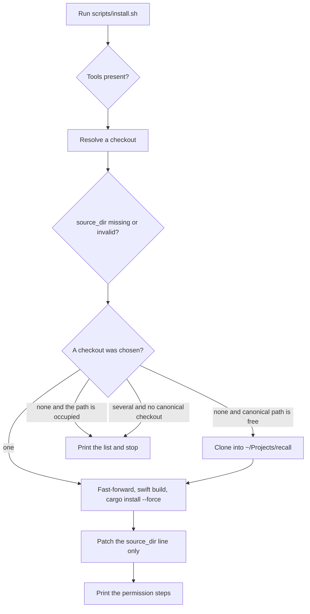

# Install and update

Matthew wants one obvious way to install Recall on a Mac and the same way to update it later. A fresh Mac, a second Mac, and a Mac that already has an older `recall` should not require a different recipe.

He also said this, and this note treats it as a bug in the current design.

> needing to hand-edit config when `source_dir` names a deleted or moved checkout is not acceptable.

The broader bar is zero manual steps beyond one install command and the one-time macOS permission grants. This file records what the program does today at `76fd97c`, the command to build, every step that would still need a person, and the decisions still open. It does not change the program. Building it waits for an explicit yes.

## What the program does today

### The installed command and the checkout are different things

`cargo install --path . --locked` is the documented way to put `recall` on the command path. `recall update` is a different command. After it finds a checkout it runs `cargo test --locked`, `swift build --package-path <checkout>/capture-helper`, and `cargo install --path <checkout> --locked --force` (`src/update.rs` lines 158-189). The install command does not pass `--root`. Cargo writes the binary into its own bin directory. `docs/PORTABILITY.md` says that directory is usually `~/.cargo/bin`. `CARGO_HOME`, or Cargo's `install.root`, sends it somewhere else. The update code never reads `PATH` and never reads the path of the running executable.

The `--force` flag is only on the update path. `README.md` and `docs/SETUP.md` tell a first install to run `cargo install` without `--force`. Update replaces the Cargo-installed binary. Nothing in `src/update.rs` or `recall doctor` searches `PATH` for a second `recall`. A copy that appears earlier on `PATH` keeps running. The shell never reaches the binary Cargo just replaced.

`recall --version` prints the crate version baked into that binary (`src/main.rs` line 72). The crate version at this commit is `0.7.5` (`Cargo.toml` line 3). The git commit is embedded as `RECALL_BUILD_COMMIT` (`build.rs` lines 31-53). `recall --version` does not print it. If the worktree was dirty at compile time, the commit string ends in `-dirty`. Update treats "already up to date" as true only when the checkout `HEAD` equals `origin/main` and that same string equals `RECALL_BUILD_COMMIT` (`src/update.rs` lines 105-108 and 544-546). A `-dirty` build never matches, so update rebuilds every time.

There is no `scripts/install.sh`. `scripts/install-git-hooks.sh` only sets `core.hooksPath`. `docs/ROLLBACK.md` says Recall has no tags and no GitHub releases. GitHub Issues for this repository has never had an issue. That was checked on 2026-11-14 with `gh issue list --state all`. The commit that added checkout discovery, `c5d5608`, has the subject "Consolidate session output and add safe updates" and no further rationale in the message.

### Finding the checkout is strict, and a bad `source_dir` stops the search

`discover_checkout` in `src/update.rs` lines 224-276 tries these, in order.

1. `--repo`, if you passed it. An invalid path is an error. The search does not continue.
2. `RECALL_REPO`, if the variable is set. Same hard stop.
3. `source_dir` from config, if the key is set. Same hard stop. The error says the checkout from `source_dir` is not valid.
4. The checkout path compiled into the binary, `CARGO_MANIFEST_DIR`.
5. Ancestors of the current directory.
6. One path under `$HOME`, and only if exactly one of these exists and is a valid checkout. `Projects/recall`, `Developer/recall`, `src/recall`, `Source/recall`, `Code/recall`, `code/recall`, `Workspace/recall`, `workspace/recall`, `Documents/recall`, `Documents/GitHub/recall`, `Documents/Projects/recall` (`src/update.rs` lines 690-710).

A valid checkout has `Cargo.toml`, `capture-helper/Package.swift`, a git root equal to that directory, and `origin` pointing at `github.com/matthewpergolski/recall` (`src/update.rs` lines 292-320). `https`, `ssh`, and `git@` forms of that remote are accepted.

Two valid common locations produce an error that lists them and tells you to pass `--repo`. Zero locations produce an error that names `--repo`, `RECALL_REPO`, and `source_dir`. Update never clones.

While the compiled-in checkout still validates, it is chosen before the current directory. `recall update` run inside a second clone updates the clone this binary was built from. The directory you are standing in is used only when that compiled-in path no longer validates, and no earlier source named a checkout. When `main` is behind `origin/main`, the fast-forward moves `HEAD`. When `main` has commits that are not on `origin/main`, the command refuses to install. The error still says "Recall pulled safely" (`src/update.rs` line 413). The code fetches, then runs `git merge --ff-only`.

`docs/SETUP.md` describes a different order. It says the updater uses the embedded checkout first, then `RECALL_REPO`, then `source_dir`. `docs/PORTABILITY.md` matches the code. An invalid `source_dir` does not fall through in either document. The code returns at `src/update.rs` lines 236-238.

That is the bug. After a checkout is deleted or moved, `source_dir` still names the old path. The next `recall update` stops. The config file has to be edited by hand before any later candidate is tried. A second clone that sits in `~/Projects/recall` is ignored for as long as the stale key is set.

Update also refuses a dirty tree, a branch other than `main`, an upstream other than `origin/main`, and a `main` that is not exactly `origin/main` (`src/update.rs` lines 365-414). It does not reset, stash, or discard. A fast-forward uses `git merge --ff-only`.

### The helper stays inside the checkout that compiled `recall`

`build.rs` does not run `swift build`. At runtime the mic recorder, the system-audio recorder, source listing, and Apple Speech all look for a debug binary under the compiled-in checkout.

The three paths, first hit wins, are `capture-helper/.build/debug/recall-capture`, `capture-helper/.build/arm64-apple-macosx/debug/recall-capture`, and `capture-helper/.build/x86_64-apple-macosx/debug/recall-capture` (`src/mic_recorder.rs` lines 261-268, and the same list in `src/system_recorder.rs`, `src/capture_sources.rs`, and `src/transcription.rs`). There is no release path. If none of those files exist, Recall runs `swift run recall-capture` with the working directory set to that `capture-helper` folder.

The fresh-install docs never run `swift build`. Update, the move steps in `docs/PORTABILITY.md`, and the rollback steps in `docs/ROLLBACK.md` do. Until a debug binary exists, the first capture pays for a Swift build, and only if the compiled-in checkout is still at that path. Move the folder without reinstalling and the helper lookup points at the old path. `docs/PORTABILITY.md` says packaging the helper into the installed command is later work. `README.md` still lists packaging as in progress.

`recall-capture version` prints `recall-capture 0.1.0` (`capture-helper/Sources/RecallCapture/main.swift` lines 324-325). That string is not the crate version. Doctor never runs it.

### Doctor checks the toolchain

`recall doctor` prints and exits 0. Extra words are ignored, so `recall doctor transcription` is the same command. `docs/DEPENDENCIES.md` lists `recall doctor transcription` and `recall setup transcription` as future commands.

Doctor reports `rustc`, `cargo`, and `swift` on `PATH`, then `swift` a second time as the helper runner. It tells you to run `recall audio-tap-probe`. It does not run the probe and it does not look for `recall-capture` (`src/main.rs` lines 1355-1362). A missing helper shows up only inside the Apple Speech lines, and only when `swift` is also missing. When `swift` is on `PATH`, doctor resolves the helper to the package directory and can end up driving `swift run` (`src/transcription.rs` lines 1253-1282).

Doctor does not print the running `recall` path, the crate version, `RECALL_BUILD_COMMIT`, or the checkout `HEAD`. It does not warn about a second `recall` on `PATH`. It does not read microphone or system-audio permission. The helper can report microphone status from `list-sources` (`capture-helper/Sources/RecallCapture/main.swift`). `recall sources` is what surfaces it. System-audio permission belongs to the terminal that launched Recall (`docs/SETUP.md` lines 198-216, `README.md` lines 35-37). The `recall` binary has no grant of its own.

### Settings survive a reinstall on the same Mac

Config is `$XDG_CONFIG_HOME/recall/config.toml` when that variable is set, including when it is empty. Otherwise it is `$HOME/.config/recall/config.toml` (`src/config.rs` lines 159-167). `session-places.txt` sits beside that file (`src/places.rs` lines 16-30). `RECALL_SESSION_PLACES` points the list at another file. There is no `RECALL_CONFIG`.

Nothing in the product writes `config.toml`. The parser skips unknown keys and comments. A missing file loads defaults. `recall update` reads `source_dir` and does not open the file for writing. It does not open `session-places.txt`. Session folders, `models/`, and `tools/` stay where they are. A new clone does not contain them. `.gitignore` ignores `models/`, `tools/`, `sessions/`, and `capture-helper/.build/`.

`keep_audio` accepts only the bare words `true` and `false` (`src/config.rs` lines 180-186). Quoted `"false"` is ignored, and an ignored value means keep the audio.

Sessions go to `--storage`, then `storage_dir`, then `<current directory>/sessions` (`src/session.rs` lines 124-126). The places list is a path per line. `recall places` prints `missing` when a path is not a directory. Temp directories are not recorded.

Copying `config.toml` to a new Mac does not copy `session-places.txt`, the session folders, model files, the checkout, or the binary. A `source_dir` or `storage_dir` written as an absolute path still names the old disk. A `~/` value expands with the new `HOME`. Microphone and system-audio grants stay with the terminal app on that Mac. They are not files in `~/.config/recall`.

Model lookup also checks `~/Library/Application Support/recall/models/` when that directory is already there (`src/transcription.rs` lines 1083-1084 and 1501-1505). Install and update do not fill it.

### The docs leave the choice open

A reader of `README.md` or `docs/SETUP.md` clones the repo and runs `cargo install --path . --locked`, or skips the install and uses `cargo run`. Later they are told to run `recall update` from any directory. Neither page installs the Command Line Tools, rustup, git, or ffmpeg. `docs/DEPENDENCIES.md` says ffmpeg comes from Homebrew or a corporate binary, and the Homebrew block installs `whisper-cpp` only. `recall update` does not install ffmpeg, `parakeet-mlx`, `whisper-cli`, or model weights (`docs/DEPENDENCIES.md` line 63).

The default engine on Apple Silicon macOS 26 and later is on-device Apple Speech. That path has no install command. Parakeet is a fallback you install with `uv tool install parakeet-mlx`. Homebrew is allowed for ffmpeg and for `uv`. The docs say not to expect a Homebrew formula for `parakeet-mlx`. They never offer `brew install recall`, a prebuilt binary, or a curl installer.

## Four flows

### Fresh Mac

Today you install the Command Line Tools, rustup, and git yourself. You clone. You run `cargo install` without `--force` and without `swift build`. You grant Microphone and System Audio Recording Only to the terminal that will launch Recall, then quit that app and open it again. You notice ffmpeg only when a transcription needs it.

The design replaces the clone, the Swift build, and the Cargo install with one command. The Apple dialogs stay.

### Mac with an older install

Today the docs still say `cargo install` without `--force`, which is the first-install line, or `recall update`, which only works when discovery finds a clean official checkout. An older binary that has no `update` subcommand cannot repair itself. A binary that has `update` and a stale `source_dir` stops and asks for a config edit. A second `recall` earlier on `PATH` is invisible.

The design uses the same command as a fresh Mac. It replaces `~/.cargo/bin/recall`, builds the helper in the checkout it actually found, and rewrites a stale `source_dir`. It does not delete other binaries. Doctor names them.

### Routine update

Today `recall update` is the right command only when the checkout is clean, on `main`, tracking `origin/main`, and discovery succeeds. If `HEAD` already matches the embedded commit, update prints `Already up to date (<version>).` and does not rebuild a deleted helper.

The design keeps that fast path for a clean match, and the one install command remains safe to run when you are not sure. Both enter the same checkout repair.

### Moving settings to another Mac

Today a reinstall on the same Mac leaves `config.toml` and `session-places.txt` in place. A new Mac starts empty. Copied session paths read as `missing` until the folders are there. Copied `source_dir` is the bug above.

The design does not sync settings. If you copy the two files onto the new Mac first, the install command rewrites a stale `source_dir` and leaves every other line alone. Session folders stay a copy you do yourself. Permission grants are new on that Mac, per terminal app.

## The design

This is the behavior to build. The program does not do it yet.

One command is `scripts/install.sh`. Run it on a Mac that has never seen Recall and on a Mac that already has it. After this design is installed, `recall update` performs the same checkout repair, so the old habit is safe. The docs name `scripts/install.sh` only.

On a Mac with no checkout yet, the command you can paste is the script from `main`.

```sh
curl -fsSL https://raw.githubusercontent.com/matthewpergolski/recall/main/scripts/install.sh | sh
```

Re-running that line is the update. The script is also safe to run from a checkout you already have.

```sh
~/Projects/recall/scripts/install.sh
```

The script is idempotent. A second run that finds the toolchain, a clean checkout at `origin/main`, a helper binary, and `~/.cargo/bin/recall` built from that commit does the checks and exits. It does not discard git changes. It does not delete session files, model files, or `session-places.txt`. It does not rewrite any config line except `source_dir`, and only in the cases below.

### What the script does

1. If `xcode-select -p` fails, run `xcode-select --install` and wait until the tools exist or you cancel the dialog.
2. If `cargo` is missing, install rustup into `~/.cargo` with the upstream noninteractive install. If `rustc` is older than `rust-version` in `Cargo.toml`, run `rustup update stable`.
3. If `ffmpeg` is missing and `brew` exists, run `brew install ffmpeg`. If `ffmpeg` is missing and `brew` does not exist, print the existing hint from `src/transcription.rs` and keep going. Recall still installs.
4. Choose a checkout with the rules in the next section. If none exists, `git clone https://github.com/matthewpergolski/recall.git` into `~/Projects/recall`. If that path exists and is not a valid Recall checkout, stop. Do not delete it.
5. If the checkout is dirty, or not on `main` tracking `origin/main`, stop and print the git status or the branch. Do not stash and do not reset.
6. Fast-forward `origin/main` when `HEAD` is behind it.
7. `swift build --package-path <checkout>/capture-helper`.
8. `cargo install --path <checkout> --locked --force`, which replaces `~/.cargo/bin/recall`.
9. Patch `source_dir` when the rules say to write it.
10. Print the permission steps for the terminal that launched the script. Print one line when this shell still cannot see `recall` and a new terminal window will.

`recall update`, once rebuilt by this design, starts at step 4. It does not install the Command Line Tools, rustup, or ffmpeg. If no checkout exists it prints the one script command and exits. It does not clone. The script is the only cloner. That keeps a surprise `recall update` from creating `~/Projects/recall` on a machine where you were not asking for a clone.

The script does not call the old `recall update` to decide where the checkout is. An older binary still has the hard stop on `source_dir`. The script finds the checkout itself, installs the new binary, and only then is `recall update` safe.

### A stale `source_dir` heals itself

This is the bug fix. Discovery no longer treats a set `source_dir` as fatal when that path is missing or is not a valid Recall checkout.

Resolution order.

1. `--repo` when passed. The path must be valid. This run writes `source_dir` to that absolute path, so the next run does not need the flag.
2. `RECALL_REPO` when set. The path must be valid. This run writes `source_dir` the same way. A wrong value is an error and the search stops, because you set it for this process.
3. `source_dir` when it is set and valid. Use it. Write nothing.
4. When `source_dir` is missing, or set and invalid, remember that it needs a write and keep looking.
5. The compiled-in checkout, when it is valid.
6. A valid ancestor of the current directory.
7. `~/Projects/recall`, when it is valid. This is the canonical clone. It wins over other common folders so two leftover clones do not block you when the canonical one is present.
8. Exactly one other valid common folder from the list already in `src/update.rs`.
9. Otherwise stop and print every valid checkout that was found. Print the one script command when the list is empty.

A checkout moved to a path that is not on the common list is found when you run the script from inside that directory. The ancestor walk selects it, and the patch writes `source_dir`. Running the script from your home directory in that case clones a new `~/Projects/recall` and leaves the moved tree where it is. Run the script once from the moved tree when that tree is the one to keep.

When step 4 marked the key as needing a write, and a checkout was chosen, replace the `source_dir` line or append one. The edit is a text patch of one line. The current parser drops comments and unknown keys, so a round trip through it would delete them. The patch replaces a single line that starts with `source_dir` and optional spaces around `=`. If the file has no such line, it appends `source_dir = "<absolute path>"`. If the file does not exist, it creates a file that contains only that line. Paths are quoted so a space survives `parse_string`. `session-places.txt` is not opened.

Doctor grows four checks. None of them start a Swift build.

- `source_dir` missing, or set and invalid. Print the path and the reason. When another checkout would be chosen, print the path the next update will write.
- Every `recall` on `PATH`, in order. When more than one exists, say that the shell runs the first. Do not delete any of them.
- The three helper binaries. When none exist, say so, even if `swift` is on `PATH`.
- `recall <crate version>`, `RECALL_BUILD_COMMIT`, and the checkout `HEAD`. Warn when the commit and `HEAD` differ.

Doctor still exits 0. It is a report. `recall --version` stays the crate version so existing callers do not break.



`recall update` enters at "Resolve a checkout" and does not install tools. An empty result prints the script command instead of cloning.

### What the command refuses to touch

Session folders, `session-places.txt`, every config key other than `source_dir`, `models/`, `tools/`, and the Application Support model cache. A dirty checkout. Any git remote that is not the official repository. Any binary outside `~/.cargo/bin`. macOS permission decisions.

## Steps that still need a person

The goal is one command plus the permission grants. This is every manual step in the current setup, and what happens to it.

| Step today | What removes it |
| --- | --- |
| Install Xcode Command Line Tools by remembering `xcode-select --install` | The script runs that command and waits. The Apple dialog still needs a click. That click is one-time per Mac and is the same class of step as the permission grants. |
| Install rustup, then `rustup update` when Rust is older than 1.95 | The script installs rustup into `~/.cargo` when `cargo` is missing, and updates stable when `rustc` is older than `Cargo.toml`. This uses the network. It is an open decision below. The default in this note is yes. |
| `git clone` | The script clones into `~/Projects/recall` when no valid checkout exists. |
| `cargo install` without `--force`, and a separate `swift build` | The script always builds the helper and always installs with `--force`, so an older `~/.cargo/bin/recall` is replaced. |
| Remember `recall update` versus `cargo install` | The docs name `scripts/install.sh` only. Re-running it updates. `recall update` calls the same repair after the new binary is installed. |
| Edit `source_dir` after a move or a delete | Fall through, then patch that one line. This is the bug. |
| Pass `--repo` on every update when two clones exist | Prefer the compiled-in checkout, then `~/Projects/recall`. A remaining pair with no canonical checkout is printed once. `--repo` writes `source_dir`, so the choice does not recur. |
| Put `~/.cargo/bin` on `PATH` | rustup writes the shell profile. The script calls the new binary by its full path. When the current shell still cannot see `recall`, the script says to open a new terminal. |
| Install ffmpeg | When `brew` exists, the script installs ffmpeg. When it does not, the script prints the hint already in `src/transcription.rs` and Recall still installs. The no-brew case stays manual. |
| Install `parakeet-mlx` or a Whisper model | Not part of the default Apple Speech path. The command does not install them. They stay manual, and only if you select that engine. |
| Grant Microphone to the launching terminal | Cannot be removed. A script that granted this would be a permission bypass, which Recall does not do. The script names the terminal and the Settings pane. Doctor repeats the same lines. |
| Grant System Audio Recording Only, then quit and reopen that app | Same constraint. A new shell tab is not enough. The script says to quit the app. Each terminal app is a separate grant. Apple Terminal, Ghostty, VS Code, and Codex stay separate. |
| Clean a dirty install checkout, or get it back onto `main` | Stays manual on purpose. The command does not stash or reset. Doctor names the dirty files or the branch. Day-to-day edits belong in a second clone. The install checkout is the one the command fast-forwards. |
| Delete a stray `recall` that appears before `~/.cargo/bin` on `PATH` | Doctor prints every match and says which one the shell runs. The command does not unlink a binary it did not install. |
| Copy `config.toml` and `session-places.txt` to a new Mac | Stays manual. The command does not pull settings over the network. If you copy the files first, only a stale `source_dir` is rewritten. Session folders are a separate copy. `recall places` already prints `missing` for a path that is not on this Mac. |
| Choose a stable `storage_dir` | Stays unset. The default remains `<current directory>/sessions`. `~/Documents/Recall/sessions` is a poor default because Documents may be in iCloud, and doctor already warns on that. Set `storage_dir` yourself if you want one folder. |

## Alternatives

A Homebrew tap was the obvious package. It fails the constraints that already shape Recall. The app is one personal repository, updated from `origin/main` by a local build. The helper is a Swift package built inside the checkout. Homebrew would add a formula and a bottle, and a bottle still would not hold the microphone grant, because that grant belongs to the terminal that launches `recall`. `docs/DEPENDENCIES.md` already says the app must not assume Homebrew. Homebrew remains acceptable for ffmpeg on a personal Mac. It is the wrong home for `recall` itself.

A prebuilt release binary has the same gap, and `docs/ROLLBACK.md` says there are no GitHub releases yet. A binary built on one Mac embeds `CARGO_MANIFEST_DIR` from that Mac. Copied to a second Mac, the helper lookup points at a path that is not there. Shipping a binary means changing helper discovery first. That is real work, and it is larger than the bug above. This plan leaves packaging as the future task `docs/PORTABILITY.md` already names.

A signed Recall application would let macOS attach the grants to Recall instead of to the terminal. That is a different product. The current permission model is deliberate. `docs/SPEC.md` lists bypassing permission prompts as a non-goal. This plan does not change who holds the grant.

Making `recall update` the only command cannot cover a Mac with no `recall` binary. The script is the command that exists before the binary does. After the first successful run, `recall update` and the script share the repair so either habit converges. The docs still show one line.

Keeping `source_dir` as a hard pin is the current code. It is the bug. A pin that points nowhere should not outrank a checkout the binary was built from, or `~/Projects/recall`.

Auto-stashing or resetting a dirty checkout would make the update succeed more often and would throw away the safety `src/update.rs` was written to keep. The command keeps refusing.

Syncing `~/.config/recall` across Macs would remove the copy step and would fight the local-first rule. `docs/SPEC.md` lists cloud sync as a non-goal. A later `recall settings export` could copy `config.toml` and `session-places.txt` and nothing else. It is not in the phases below.

`docs/DEPENDENCIES.md` lines 219-228 already sketch `recall setup transcription`. That command is for transcription tools. The paragraph says setup asks before it downloads anything, and that a corporate machine can place binaries by hand. It is not an installer for the `recall` binary. The script in this note is that missing installer. Downloading rustup and ffmpeg is the open decision below, because that paragraph and the one-command goal pull in opposite directions.

## Phases

Each phase is its own pull request. Each one ends in a check you can run. Phases that change `src/` bump the patch version by 1, and `Cargo.lock` matches, per `scripts/check_version_bump.py`. This document does not bump the version.

### 1. Fall through a stale `source_dir`

Change `discover_checkout` so an invalid `source_dir` is skipped. A valid `source_dir` still wins and does not look further. `--repo` and `RECALL_REPO` still fail when the path is invalid. The compiled-in checkout is next, then the current directory, then `~/Projects/recall`, then exactly one other common checkout.

Tests, next to the fixtures already in `src/update.rs`.

- A `source_dir` whose directory does not exist yields the compiled-in checkout when that checkout is valid.
- A valid `source_dir` is used even when `~/Projects/recall` is also valid.
- An invalid `RECALL_REPO` is an error and does not fall through.
- Two common checkouts, no canonical path, and a stale `source_dir` return the list and do not pick one.
- `~/Projects/recall` wins when it is valid and another common folder is also valid.

`./scripts/check.sh` is the check. No config file is written in this phase.

### 2. Patch `source_dir` in place

Add a text patch that replaces or appends the one line. Call it only after a checkout has been chosen and the rules say to write. Call it even when a later git check refuses the update, so the next run can find the checkout without the flag.

Tests.

- A file with a comment, an unknown key, and `storage_dir` keeps those bytes except for the `source_dir` line.
- A missing `source_dir` line is appended. The other lines stay.
- A missing file is created with only that line.
- `session-places.txt` in the same directory is byte for byte unchanged.
- A path with a space round-trips through `RecallConfig::parse`.

### 3. Doctor reports a stale install

Extend `print_doctor` with the four checks above. Tests set `HOME`, `XDG_CONFIG_HOME`, and `PATH` to temp directories and assert the printed lines. A stale `source_dir` prints `warn` and the replacement path. Two `recall` binaries print in order. A missing helper prints `warn` without invoking `swift`. A commit mismatch prints both strings. Doctor still exits 0.

### 4. `scripts/install.sh`

The script implements the steps in "What the script does". `scripts/install.sh --plan` prints the actions and changes nothing. Tests run the plan against a fake `PATH` and a temp `HOME`.

- A second plan, after the fake tools and a clean checkout are in place, prints that there is nothing to change.
- A stale `source_dir` shows a rewrite of that line and does not show a rewrite of `storage_dir`.
- A dirty checkout shows a stop, and the plan names a file, and it does not show a reset.
- A missing canonical directory shows a clone. A canonical path that is a non-git directory shows a stop and does not show a delete.

The real Command Line Tools dialog, rustup download, `swift build`, and `cargo install` are macOS checks. They are not part of `./scripts/check.sh`.

### 5. Point the docs at the one command

Change `README.md`, `docs/SETUP.md`, and `docs/PORTABILITY.md` so the install and update instructions are the script. Fix the discovery order in `docs/SETUP.md`. State that a stale `source_dir` is rewritten. Leave the permission section as the human step. `git diff --check` is the check. No version bump.

## Open decisions

These defaults are what the phases above assume. Each one is a preference. Say so in a sentence and the phase changes. Nothing here is a token to type back.

The script may download rustup and may run `brew install ffmpeg`. The default is yes, because otherwise a fresh Mac still has a toolchain scavenger hunt, and the goal was one command. `docs/DEPENDENCIES.md` says a future setup command asks before downloading. Say "do not let the script install rustup or ffmpeg" if those stay prerequisites you install yourself. Say "ask before each download" if the script should stop and wait for a yes before rustup or ffmpeg.

The canonical clone path is `~/Projects/recall`. The default is that path because it is already the first common candidate in `src/update.rs`. An existing valid checkout is never moved. Say "use this other directory as the canonical clone" and name the path if you want a different one.

When `--repo` or `RECALL_REPO` succeeds, the run writes `source_dir`. The default is yes, so a one-time choice sticks. Say "do not write `source_dir` from `RECALL_REPO`" if a temporary env var must not become the pin. `--repo` should still write, or the two-checkout list comes back on the next run.

`recall update` does not clone. The default is that only the script creates `~/Projects/recall`. Say "let `recall update` clone when nothing is installed" if you want the binary alone to finish a machine that has no checkout.

A `recall settings export` command is not in the phases. The default is that you copy `config.toml` and `session-places.txt` yourself when you want them on a new Mac. Say "add an export command that copies those two files and no session audio" if you want that as a sixth phase.

`storage_dir` stays unset. Say "set a default storage directory on first install" and name a path outside iCloud if you want the script to write that key too. The patch would still be one line, and it would write the key only when it is absent.

## Out of scope

Packaging `recall-capture` next to the Cargo binary. A signed application. A Homebrew formula for Recall. GitHub release artifacts. Installing Parakeet, Whisper, or model weights. Granting macOS permissions from the script. Syncing sessions or config to another Mac. Resetting a dirty checkout. Deleting extra `recall` binaries. Changing `recall --version` to print the git commit.
